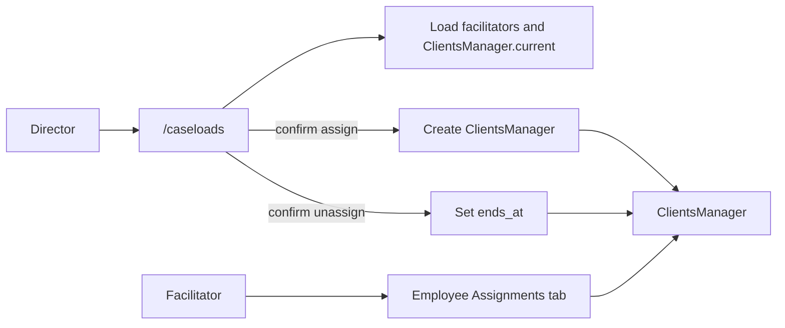

# Caseload assignment (reuse ClientsManager)

## Product rules

- A **case** is a client on a facilitator's caseload.
- Caseload data is existing [`ClientsManager`](app/models/clients_manager.rb) rows (`manager` = employee, `client` = client, dated `starts_at` / `ends_at`, `.current`).
- **Facilitators** are employees whose current job title slug is `facilitator`.
- **Unassigned** clients are clients with no current `ClientsManager` to any facilitator.
- Assign / unassign is a deliberate confirmed action (same weight as payroll approve confirm), not a quiet dropdown save.
- Existing Employee Assignments and Client Care Services panels stay; they remain the per-record editors. The new surface is org-wide.

## Auth and job-title seeds

Ship permissions with the feature so `db:seed` / dev reset leaves Director able to open Caseloads and Facilitator unable to.

1. Add `"clients_manager" => ClientsManager` to [`Employee::JobTitle::PermissionsCatalog::RESOURCES`](app/services/employee/job_title/permissions_catalog.rb) so the Job Titles matrix shows Caseload / clients_manager actions.
2. Add [`ClientsManagerPolicy`](app/policies/clients_manager_policy.rb) (standard job-title `index` / `show` / `create` / `update` / `destroy`). Inertia will expose `permissions.clients_managers.*` via the existing policy scanner.
3. Update [`db/seeds/02_required_permissions.rb`](db/seeds/02_required_permissions.rb):
   - **Facilitator:** explicit `"clients_manager" => { index/show/create/update/delete: false }` (org-wide birds-eye stays closed; per-client manager edits keep using nested routes + `ClientPolicy#update?` / `manages_client?`).
   - **Director:** keep `"admin" => true` so `SyncPermissions` grants every catalogued action on `ClientsManager` after reset (same as other resources).
4. Gate sidebar + Spotlight "Caseloads" on `can("clients_managers", "index")`.
5. `CaseloadsController` authorizes `ClientsManager` (`index?` for the page; `create?` / `update?` or `destroy?` for assign/unassign).

Also extend any Facilitator seed hash / empty-permissions specs that enumerate catalog keys so the new resource does not break SyncPermissions / PermissionsReader coverage.

## Backend

**Routes** (top-level, beside payroll):

- `GET /caseloads` - birds-eye Inertia page
- `POST /caseloads` - assign (`client_id`, `manager_id` → create `ClientsManager`)
- `DELETE /caseloads/:id` or `PATCH` with `ends_at` - unassign (end the open row)

**Controller** [`app/controllers/caseloads_controller.rb`](app/controllers/caseloads_controller.rb):

- `index`: load one coherent page set
  - facilitators: employed employees with current job title `facilitator`, ordered stably
  - current facilitator `ClientsManager` rows for those ids only
  - clients currently on those caseloads
  - unassigned clients (active clients with no current facilitator manager link)
- Derive lockstep maps from that one load (e.g. `client_ids_by_facilitator`, `caseload_counts`, assignment row ids). Spec that rendered facilitator ids match map keys and assigned client ids match the unassigned complement for the facilitator-managed set.
- `create` / end-assignment: wrap `ClientsManager` create or `ends_at = Time.current`; paper_trail already audits; flash + redirect back to `/caseloads`.

**Serializer** (e.g. `Caseloads::IndexSerializer` or a small service + serializers): facilitators (employee identity + count), assignments (id, manager_id, client_id, starts_at), unassigned clients. Reuse existing employee/client persisted serializer shapes where possible.

**Query helper** (prefer a small PORO under `app/services/caseloads/` or model scopes):

- `Employee` scope for current facilitators by job title slug
- Unassigned clients query scoped through `ClientsManager.current` + facilitator manager ids

## Frontend

**Page:** [`app/frontend/pages/Caseloads/index.tsx`](app/frontend/pages/Caseloads/index.tsx) (Inertia default export) composing a domain board.

**Domain:** [`app/frontend/domains/Caseloads/`](app/frontend/domains/Caseloads/)

Layout inspired by payroll work-queue / dashboard board (one composition, metrics + roster):

1. **Metrics** via shared `features/RecordShow/Board` (`MetricLine` / `CountChip`): facilitator count, clients on caseload, unassigned count.
2. **Facilitator roster table**: name, caseload size; row opens/expands that facilitator's client list with Unassign (confirm).
3. **Unassigned clients** section: client list with Assign action → confirm modal (pick facilitator if none selected, or assign to focused facilitator).
4. Writes via Inertia to `/caseloads` (not nested employee/client routes) so redirect stays on the birds-eye.

Reuse existing dropdowns (`EmployeesDropdown` filtered to facilitators / `ClientsDropdown`) and `confirmBusyAction` (or the payroll confirm pattern) for assign/unassign.

**Nav:** sidebar + Spotlight entry "Caseloads" gated on `can("clients_managers", "index")`, linking to `Routes.caseloads()`.

**i18n:** `config/locales/caseloads/frontend.en.yml` under `views.caseloads.*`; controller notices via existing notice templates with model name.

## Specs (required)

- Seed / catalog: Facilitator lacks `ClientsManager` index/create; Director (`admin: true`) gains them after `SyncPermissions`.
- Policy: Facilitator denied org-wide; Director (or user with clients_manager roles) allowed.
- Request/controller: index props lockstep (facilitator ids ↔ assignment map keys; unassigned excludes assigned); assign creates current `ClientsManager`; unassign ends it; unauthorized facilitator cannot index/mutate org-wide.
- Model/query: facilitator scope; unassigned definition.
- Frontend smoke: board renders metrics + tables; confirm path present (behavior-level, not layout trivia).

## Out of scope for this slice

- New `Case` / `Caseload` table
- Reworking Assignments / Care Services tabs beyond optional shared copy ("Caseload" label) if you want wording aligned later
- Incident/work-item case tracking

