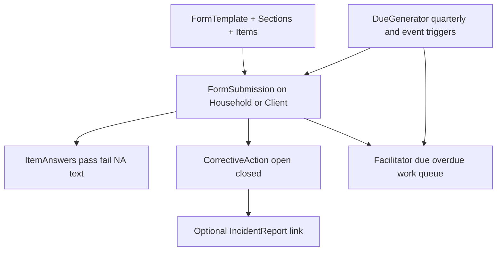

# Compliance form capture for hazard assessments

## Why Google Forms fails here

The pasted Hazard Assessment form is a **scheduled, client-home compliance record** with findings and corrective actions. Spreadsheet/email capture cannot:

- Tie a submission to a `Client` / `Household`
- Show overdue quarterly inspections on a facilitator caseload
- Track open corrective actions until closed
- Gate or audit who can complete vs review
- Spawn or link an `IncidentReport` when a finding warrants one

## Recommendation: Phase 12 form engine, first template = this checklist

Do **not** stretch [`IncidentReport`](app/models/incident_report.rb) (reactive SIR event log) or [`Requirement::Requirement`](app/models/requirement/requirement.rb) (employee training/credential gates) or [`ReportDefinition`](app/models/report_definition.rb) (export runner).

Build the unchecked Phase 12 item **"Daily service notes and compliance form capture"** as a small definition/response domain. Ship the Hazard Assessment & Correction Record as the first seeded template.



## Domain shape

**Namespace:** `Compliance::` (or `Forms::` if you prefer parallel to `Reports::` — pick `Compliance::` so it reads as IIPP/QA, not export).

| Model | Role |
|---|---|
| `Compliance::FormTemplate` | Named form (e.g. Hazard Assessment); version; active; cadence (`quarterly` / `ad_hoc`); subject type (`household` preferred, fallback `client`) |
| `Compliance::FormSection` | Ordered sections (General Home Safety, Manual Transfers, Harmful Behaviors, Findings) |
| `Compliance::FormItem` | Question/check: `kind` (`boolean_check`, `text`, `date`, `person`, `conditional_group`); required; optional `show_when` for transfer/behavior blocks |
| `Compliance::FormSubmission` | One completion attempt: subject (`household_id` or `client_id`), `inspected_on`, `conducted_by` (Employee), status (`draft` / `submitted` / `closed`), `template_version` snapshot |
| `Compliance::FormAnswer` | Per-item value (pass/fail/NA + notes for checks; string for locations/DNR) |
| `Compliance::CorrectiveAction` | From findings: description, root cause, remedy, `due_on`, `closed_at`, optional `incident_report_id` |

Paper Trail on submissions and corrective actions. Attach photos/PDFs via existing `HasDocuments` if needed later.

**Subject rule:** Prefer [`Household`](app/models/household.rb) (home already has Contactable addresses and Care-tab linkage). If a client has no household, allow `client_id` alone.

## Cadence and triggers (match the form schedule)

| Trigger | Behavior |
|---|---|
| Initial / program start | Seed or admin creates baseline due submissions for active households |
| Quarterly site visit | Due = last submitted + 3 months (or calendar quarter); overdue queue for facilitators with caseload clients in that household |
| New hazard / equipment / injury / warrant | Manual "Start inspection" from Client Care or Household; optional auto-prompt when an `IncidentReport` is created for that client |

Due/overdue is a **query + work queue**, same product pattern as payroll [`WorkQueue`](app/frontend/domains/PayPeriods/WorkQueue.tsx) — not a Requirements gate.

## UI surfaces

1. **Settings > Compliance forms** — CRUD templates/sections/items (admins); seed the Hazard Assessment checklist so staff are not rebuilding Google Form text by hand.
2. **Client Show** — new tab or Care sibling: history of submissions for that client/household; Start / Continue / View.
3. **Compliance queue** (`/compliance` or under caseload) — due, overdue, open corrective actions; scoped by `ClientsManager` for facilitators, org-wide for Directors.
4. **Submission form** — sectioned checklist (Mantine + existing Inertia Form patterns under `domains/Compliance/`); conditional sections for transfers and harmful behaviors; findings require corrective action rows when any check fails.

Permissions: new catalog resource (e.g. `compliance_form_submission`) with index/show/create/update; template admin separate or Settings-gated. Do not reuse `incident_report` grants.

## How this Google Form maps

- Checkbox lines → `FormItem` `boolean_check` (Pass / Fail / N/A)
- DNR / Emergency Contacts / First Aid locations → `text` items
- Conditional blocks → section `show_when` ("manual transfers occur" / "harmful behaviors")
- Date + person conducting → submission metadata
- Unsafe conditions + corrective actions → `CorrectiveAction` records (structured, closable), not a single textarea that dies in a sheet

CPI / lifting training checks can later deep-link to requirement fulfillment display; v1 stores the attestation answer only.

## What not to build in v1

- Full drag-drop form builder for non-admins (seed + Settings CRUD is enough)
- Client portal self-service (this form is supervisor site-visit work)
- Merging into IncidentReport or Requirements
- Daily service notes in the same ship — same engine later, separate template

## Project goal in [`.cursor/icr.mdx`](.cursor/icr.mdx)

On build start, replace the single Phase 12 line `Daily service notes and compliance form capture` with:

```
- [ ] Daily service notes (same Compliance:: form engine; separate template; ship after hazard assessment)
- [ ] Compliance form engine (FormTemplate / Section / Item / Submission / Answer / CorrectiveAction; household-or-client subject; paper_trail)
- [ ] Hazard Assessment and Correction Record (seeded home-safety checklist; quarterly due queue; event-triggered starts; Client Care history)
- [ ] Compliance due/overdue work queue for facilitators (caseload-scoped) and Directors
```

On build finish, mark the three Compliance/Hazard/queue items `[x]`, leave daily service notes unchecked, and add a short **Feature Documentation > Compliance forms** note (namespace, subject rule, first template, queue entry points). Do not document implementation play-by-play.

## Implementation order

1. Write the Phase 12 goals into `.cursor/icr.mdx` (unchecked)
2. Models/migrations + seed Hazard Assessment template from the pasted checklist
3. Policies + nested Client/Household submission CRUD + serializers
4. Submission UI + Client history surface
5. Due/overdue generator + facilitator queue
6. Corrective action close-out + optional incident link
7. Specs: subject lockstep (answers belong to submission's template version); queue keys match visible households; paper_trail on submit/close
8. Mark Compliance/Hazard/queue Phase 12 items complete in `.cursor/icr.mdx` + Feature Documentation note

## Relation to roadmap

- Owns Phase 12 compliance form capture (splits daily notes to a later template on the same engine)
- Feeds Phase 10 "assessments / QA" without waiting on FIR/SIR deepening
- Leaves IncidentReport for actual incidents; a failed inspection finding may **link** an incident, not become one by default