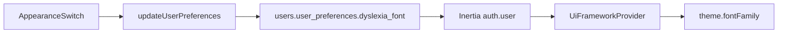

# Dyslexia font toggle

## Scope

Per-user accessibility toggle on [Appearance.tsx](app/frontend/domains/Settings/User/Appearance.tsx) (User Settings). Company settings and dark-mode persistence stay untouched.

## Approach

1. **Persist** boolean `dyslexia_font` on `User` via existing `store_accessor` / `PATCH update_user_preferences`.
2. **Toggle** in Appearance with a Mantine `Switch` (same label/description row pattern as color scheme).
3. **Apply** by reading `auth.user.user_preferences.dyslexia_font` in [UiFrameworkProvider.tsx](app/frontend/layouts/Providers/UiFrameworkProvider.tsx) and setting `fontFamily` to OpenDyslexic when on.
4. **Font files** vendor OpenDyslexic (OFL) under `public/fonts/opendyslexic/`, declare `@font-face` next to Roboto in [global.css.ts](app/frontend/layouts/Providers/global.css.ts).

## Backend

- [user.rb](app/models/user.rb): add `:dyslexia_font` to `store_accessor :user_preferences`; coerce to boolean in `coerce_json` (same pattern as `dark_mode`).
- [user_spec.rb](spec/models/user_spec.rb): extend coerce example to cover `dyslexia_font`.
- No migration (JSONB already exists). API already merges arbitrary preference keys.

## Frontend types and persistence

- [UserPreferences.ts](app/frontend/types/UserPreferences.ts): add `dyslexia_font?: boolean`.
- Wire [Appearance.tsx](app/frontend/domains/Settings/User/Appearance.tsx) to `useUpdateUserPreferences` with `auth.user.slug` (same caller pattern as [LimitSelect.tsx](app/frontend/components/Table/Pagination/LimitSelect.tsx)).
- On successful save, `router.reload({ only: ["auth"] })` so shared props (and theme) stay in lockstep.

## UI

In Appearance, add a second row below color scheme:

- Label/description from i18n in [frontend.en.yml](config/locales/settings/user/frontend.en.yml) (e.g. "Dyslexia-friendly font" / "Use OpenDyslexic for easier reading").
- Controlled `Switch` from `@/components/Inputs`, checked from `auth.user.user_preferences.dyslexia_font`, toggles preference immediately.

## Theme application

- [UiFrameworkProvider.tsx](app/frontend/layouts/Providers/UiFrameworkProvider.tsx): read `auth` from `usePageProps()`; when `dyslexia_font` is true, `createTheme({ ...themeObject, fontFamily: "OpenDyslexic, sans-serif", ... })`.
- [global.css.ts](app/frontend/layouts/Providers/global.css.ts): `@font-face` for OpenDyslexic regular (and italic/bold if vendored).

## Tests

- Model coerce for `dyslexia_font`.
- Update [Appearance.test.tsx](app/frontend/tests/domains/Settings/User/Appearance.test.tsx): mock page props + mutation; assert Switch label renders and toggle calls update with `{ dyslexia_font: true }`.
- Small Vitest on theme/provider fontFamily when preference is on (or assert theme construction helper if extracted; keep change minimal).

## Checklist

Mark Phase 8 item done in [.cursor/icr.mdx](.cursor/icr.mdx) when shipped.
