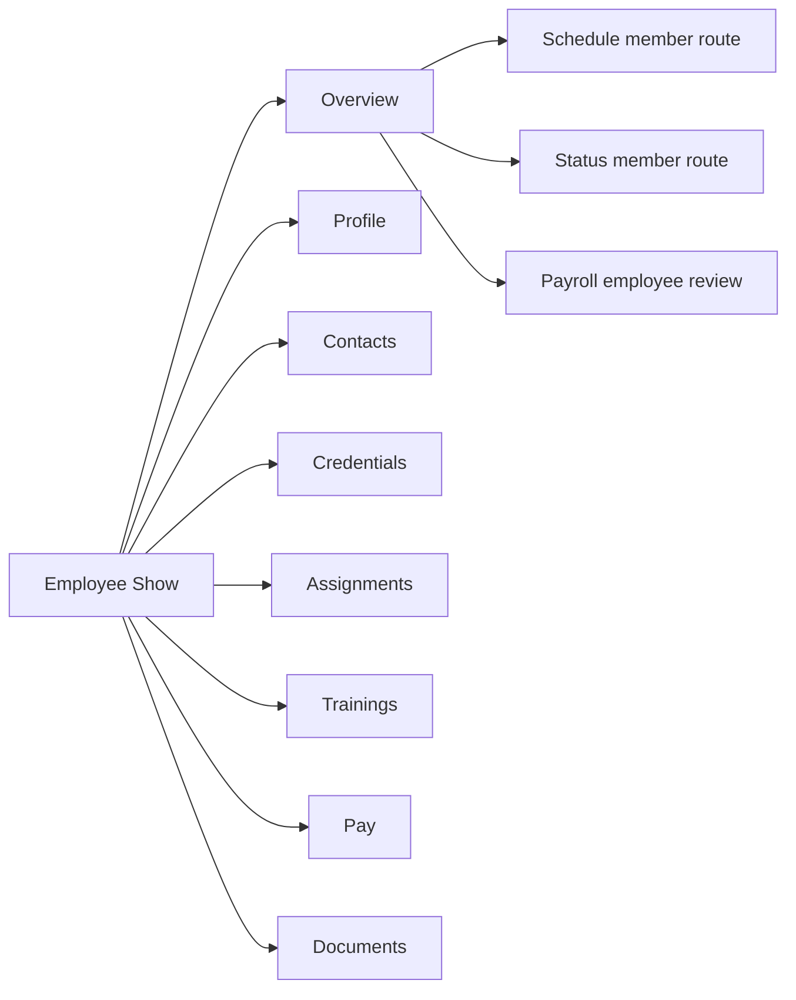

# Employee Mini-App

Handoff plan for a second agent. Mirror the Client Show architecture and depth; adapt domain content for SLS agency HR (not care-plan clinical).

## Scope locks (parallel to Client)

- **Pattern:** URL-tabbed Employee show + nested `Employees::*` write controllers under `/employees/:employee_slug/...`, authorize via `EmployeePolicy#update?` / `show?`. Schedule stays a member route with Overview deep link. One `Employee.includes_show` load + expanded `Employees::ShowSerializer` for Overview lockstep props.
- **Documents:** ActiveStorage list/upload/download/delete + image gallery (same as Client). Phase 2 versioning/categories deferred.
- **Requirements System:** Deferred (Phase 3 already marks it Future). This pass wires **training completion on the employee** using existing `Employee::EmployeesTraining`; does not build user-defined requirement rules/fulfillment engine.
- **Payroll / timesheets:** Overview + Pay tab show pay-rate history and deep links into existing payroll employee review. Do not rebuild timesheet CRUD inside Employee show.
- **Employee health:** Clearances only (TB, physical, other dated clearances with issued/expiry). Not a client-style allergies/diagnoses/medications clinical stack.
- **Status workflow:** In scope and must be repaired first (currently broken). Use AASM events; persist missing columns; align enum with AASM.

## Current state (what the agent inherits)

- Show tabs: Details (placeholder), Contacts (read-only), Documents (title stub) in [`pages/Employees/Show`](app/frontend/pages/Employees/Show/index.tsx).
- Index + filters are already mature ([`domains/Employees/Table`](app/frontend/domains/Employees/Table)).
- Status UI exists ([`pages/Employees/Status`](app/frontend/pages/Employees/Status/index.tsx)) but backend is not shippable: GET `status` mis-routes through update params; `update_status` calls undefined `employee_status_params`; `termination_reason` validated/permitted with **no column**; AASM has `application_withdrawn` but AR enum does not; forms raw-update status instead of AASM events.
- Form gaps: `color` / `job_title_id` sent but not in strong_params; no contact nested attrs ([`employees_controller.rb`](app/controllers/employees_controller.rb)).
- Models ready but unwired on show: pay rates, managers (`Employee::EmployeesManager`), client assignments (`ClientsAttendant` / `ClientsManager`), trainings join, identifications, ActiveStorage docs/images.
- Sibling catalog CRUDs at `/employees/trainings` and `/employees/interviews` stay as catalogs; employee show gets fulfillment/list surfaces that link into them.
- No `Employees::*` nested controllers yet. Client pattern to copy: [`Clients::BaseController`](app/controllers/clients/base_controller.rb) + nested resources in [`config/routes.rb`](config/routes.rb).

## Information architecture



| Tab | Job |
|---|---|
| **Overview** | Attention surface: identity, status badge, job title, hire date, manager, assigned clients counts, open training gaps, clearance expiry alerts, Schedule / Change Status / Payroll CTAs |
| **Profile** | Demographics, employee #, color, DOB, preferred language/comms notes, employment dates, eligibility fields |
| **Contacts** | Editable Person contact (phones/emails/addresses) + `Employee::SupportContact` emergency/family network (mirror Client support contacts) |
| **Credentials** | Identifications + `Employee::Credential` (CPR, First Aid, DL, licenses) with issued/expiry; clearance records (`Employee::Clearance`) |
| **Assignments** | Reporting managers (`EmployeesManager`), attended clients, managed clients; dated assignment windows |
| **Trainings** | Assigned/completed trainings via `EmployeesTraining`; add/complete against Training catalog |
| **Pay** | Pay rate history (`Employee::PayRate`); link to current payroll period review when applicable |
| **Documents** | Documents list/upload + images gallery |

Keep existing **Status** as a member route/page (not a tab), same as Schedule. Deep-link from Overview and header menu.

Domain UI under `app/frontend/domains/Employees/{Overview,Profile,Contacts,Credentials,Assignments,Trainings,Pay,Documents}/`. Page files under `pages/Employees/Show/` stay thin entrypoints (move Contacts out of pages into domains).

## Data model

### Fix / extend `employees`
- Add `termination_reason` (text), `resignation_notes` (text) — or single `status_reason` if consolidating; prefer explicit `termination_reason` + `resignation_notes` to match existing forms.
- Align AR `enum :status` with AASM: include `application_withdrawn` (or map Close Application to `declined` and remove AASM state — **choose: add `application_withdrawn` to the AR enum** to match AASM and CloseApplication form).
- Add optional profile fields used by Overview/Profile: `preferred_language`, `communication_notes` (parallel to client without CA/IHSS).

### New models under `Employee::`
- **`Employee::SupportContact`** — same shape as [`Client::SupportContact`](app/models/client/support_contact.rb): Contactable, relationship enum, priority, `is_emergency`, name fields. Table `employee_support_contacts`.
- **`Employee::Credential`** — `employee_id`, `name`, `credential_type` enum (cpr, first_aid, drivers_license, professional_license, other), `number`, `issued_on`, `expires_on`, `notes`, ActiveStorage optional file or rely on Documents tab. Table `employee_credentials`.
- **`Employee::Clearance`** — `employee_id`, `clearance_type` enum (tb, physical, other), `status` (pending/cleared/expired), `cleared_on`, `expires_on`, `notes`. Table `employee_clearances`.

### Finish existing domain (no new tables where joins already exist)
- **Identifications** — expose on Credentials tab; nested create/destroy under employee (polymorphic already on Employee).
- **Pay rates** — CRUD nested under employee; fix any Money serialization via existing serializer patterns.
- **EmployeesManager** — dated manager assignment UI on Assignments.
- **ClientsAttendant / ClientsManager** — list + assign/end on Assignments (employee as attendant or as client-manager).
- **EmployeesTraining** — assign training, mark completed (`completed_at`); list active vs completed.
- **Interviews** — Overview/Profile show recent interviews for this employee (read + link to `/employees/interviews/:id`); do not rebuild interview catalog inside the tab.
- **Orphan `employment_statuses` table** — leave unused this pass (do not invent a parallel status system; AASM on `employees.status` remains source of truth). Document as deferred cleanup.

### Explicitly deferred
- Full Requirements engine (user-defined requirements, job-title scoping, fulfillment rules)
- Phase 2 document versioning/category taxonomy
- Payroll/timesheet engine inside Employee show
- Client-style clinical meds/allergies/diagnoses for staff
- Offer-letter / I-9 packet generation
- Repairing all interview schema drift (`location`, wrong FK on notes) beyond what Employee show listing needs

## Backend shape

1. **Foundation / status repair** (do before UI deepening)
   - Migration: employee columns above; create support_contacts / credentials / clearances tables.
   - Fix [`EmployeesController#status`](app/controllers/employees_controller.rb) to **render** `Employees/Status` (stop treating GET as update).
   - Add `employee_status_params`; `update_status` transitions via AASM events (`make_offer`, `close_application`, `accept_offer`, `reject_offer`, `terminate`, `reconsider`) with permitted reason fields.
   - Expand create/update `strong_params`: `color`, job title assignment (call existing `assign_job_title`), nested `person.contact` attrs (Company/Client pattern), new profile fields.
   - Specs covering each status transition and the GET render path.

2. **Show payload**
   - Add `Employee.includes_show` (person+contact, job_title, managers, managed/attended clients, pay_rates, trainings join, credentials, clearances, support_contacts, identifications, recent interviews).
   - Expand [`Employees::ShowSerializer`](app/serializers/employees/show_serializer.rb) with nested serializers + `documents` / `images` via [`Attachments::FileSerializer`](app/serializers/attachments/file_serializer.rb) + Overview counts (assigned clients, expiring credentials/clearances, incomplete trainings).
   - Holistic integrity: one loaded graph; specs assert sibling id-keyed collections match Overview counts.

3. **Nested `Employees::*` controllers** (copy Client BaseController pattern; **always** pass `model: Employee::...` to Decent Exposure)
   - `support_contacts`, `credentials`, `clearances`, `identifications`, `pay_rates`, `managers`, `client_attendants`, `client_managers`, `trainings` (employees_trainings join), `documents`, `images`
   - Redirect back with `tab=` query like Client.

4. **Routes**
   ```ruby
   resources :employees, param: :slug, concerns: :schedulable do
     member do
       get :status
       put :status, action: :update_status
     end
     # nested resources mirroring Client block
   end
   ```
   Keep `/employees/trainings` and `/employees/interviews` sibling catalog routes.

5. **Permissions**
   - Nested writes gate on `EmployeePolicy`.
   - Add catalog resources only where job-title grants should control catalogs already policed separately (`training` is already a policy; ensure matrix keys stay coherent). Prefer not flooding catalog; employee nested HR data stays under `employee` update grant (same as Client nested care under `client` update).

## Frontend shape

- Rebuild Show tabs to the inventory above; remove placeholder Details.
- Reuse Client patterns: `railsAttributes` forms (association keys without `_attributes` suffix), `DeleteButton`, domain folder placement rules, `Routes.*` helpers, i18n under `config/locales/employees/frontend.en.yml`.
- Overview: status badge + Change Status CTA; Schedule; link to payroll employee review when a current period exists (use existing Routes helpers).
- Profile form: persist color + job title + demographics + comms.
- Contacts: mirror Client contact + support network UX.
- Credentials / Assignments / Trainings / Pay / Documents: list + create forms + delete; prefer employee/client/training dropdowns where options APIs already exist (`/api/options/employees`, clients options, trainings index) instead of raw UUID text fields (improve on Client's temporary UUID inputs where possible).
- Index: already good; only add columns that Overview makes first-class (e.g. job title already there). Do not regress filters.
- Remove or stop shipping the unused duplicate [`domains/Employees/StatusChange/index.tsx`](app/frontend/domains/Employees/StatusChange/index.tsx) page shell if it conflicts with `pages/Employees/Status` (keep the form section components).

## Seeds and specs

- Dev seeds: support contact, credential with expiry, clearance, pay rate, manager assignment, attendant client link, employees_training row for facilitator/attendant.
- Request specs: show lockstep props; status GET render + each AASM transition; nested create/destroy for support contacts, credentials, documents, trainings join, pay rates.
- Model specs for new `Employee::` models and status enum alignment.
- After serializers: `rails types_from_serializers:generate`, `rails js:routes`, `rails i18n:export`.
- Prefer `object_as ..., model:` on namespaced serializers so TypesFromSerializers infers column/enum types. Define frontend-only shapes next to the component that uses them (see Client Documents), not global Schema dump files.

## Delivery order (single feature pass, sequential slices)

1. **Foundation** — migrations; status repair (GET render, AASM `update_status`, enum/columns); strong_params (color, job title, contact nested); `includes_show` + ShowSerializer skeleton; Overview + Profile tabs; form persistence.
2. **Contacts** — editable Person contact + `Employee::SupportContact` CRUD + Contacts tab.
3. **Credentials** — Credential + Clearance models/UI; Identifications on same tab.
4. **Assignments** — managers, attended clients, managed clients.
5. **Trainings + Pay** — employees_trainings UI; pay rate history; payroll deep link on Overview/Pay.
6. **Documents + Images** — ActiveStorage list/upload/purge (copy Client Documents domain).
7. **Hardening** — i18n, routes/types generate, seeds, request/model specs, Phase 3 checklist + Feature Documentation note in [`.cursor/icr.mdx`](.cursor/icr.mdx) (Employee Show section parallel to Client Show; Decent Exposure `model:` gotcha already documented under Model Organization).

## Definition of done

A staff user opening an employee sees a truthful Overview, can maintain profile/contacts/emergencies, credentials and clearances, assignments, training completions, pay rates, and documents/images; Change Status works through AASM with persisted reasons; specs cover status transitions, nested writes, and show-prop lockstep. Requirements engine and payroll CRUD remain out of scope.

## Agent gotchas (read before coding)

- Namespace models: `self.table_name` + `class_name:` on Employee associations; Decent Exposure **must** use `model: Employee::SupportContact` (etc.) or it resolves `SupportContact` / `Allergy`-style bare constants (Client Show hit this).
- Forms: with default `railsAttributes={true}`, send nested keys as `person`, `contact`, `phones` — not `person_attributes` (would double-suffix).
- Frontend folder rules: domains under `app/frontend/domains/Employees/`; pages are thin default-export entrypoints only.
- No comments in generated code; ASCII punctuation only; no `as` casts in TypeScript.
- Do not expand into Phase 2 doc versioning or Requirements engine.
- Run focused specs for touched area before finishing; fix failures.