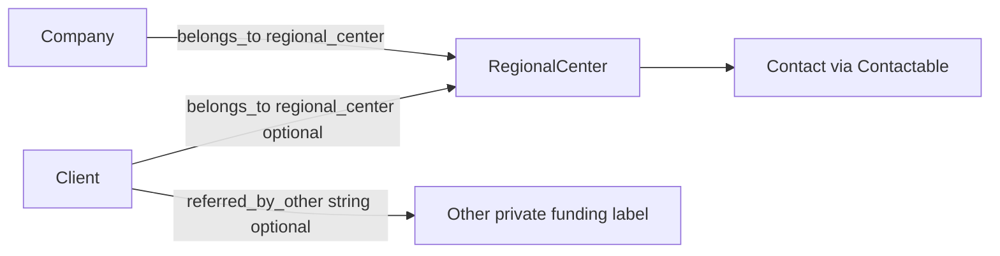

# Regional centers + company association + client referral

## Scope

Tenant-local `RegionalCenter` now. Control-plane HTTP sync later; seed from a committed CA centers snapshot.

## Data model

### `RegionalCenter`

- UUID PK; unique stable `code` (e.g. `rceb`); `name`; `active` default true.
- `include Contactable` (same as [`Vendor`](app/models/vendor.rb) / [`Company`](app/models/company.rb)).
- Seed: California DDS regional centers JSON, upsert by `code`, ensure contact exists.
- Selects list `active` centers. No full admin CRUD in this slice.

### Company settings

- [`Company`](app/models/company.rb): `belongs_to :regional_center, optional: true`.
- [`Settings/Company/Form`](app/frontend/domains/Settings/Company/Form.tsx): regional-center select.
- Controller/serializer/request specs updated.

### Client referral (replaces `regional_center` string)

Not polymorphic. Two mutually exclusive options:

| Choice | Columns |
| --- | --- |
| Referred / funded via regional center | `regional_center_id` set; `referred_by_other` blank |
| Privately funded / other | `referred_by_other` string set; `regional_center_id` nil |

- Drop `clients.regional_center` string.
- Add `regional_center_id` (FK, optional) and `referred_by_other` (string, optional).
- Validation: at most one of the two set; both may be blank.
- UI: source toggle or select ("Regional center" / "Other"), then either center select or text field. Replace inputs in [`Clients/Form`](app/frontend/domains/Clients/Form/index.tsx) and [`Clients/Profile/Form`](app/frontend/domains/Clients/Profile/Form.tsx).
- Overview/show: regional center name, or the other string, or "-".
- Migration: map existing `regional_center` values to a matching `RegionalCenter` by name/code when possible; otherwise copy into `referred_by_other`.

## Non-goals this slice

- Control-plane app, HTTP sync, billing/marketing.
- Full RegionalCenter contact admin UI (Contactable on model + seeds; admin later).
