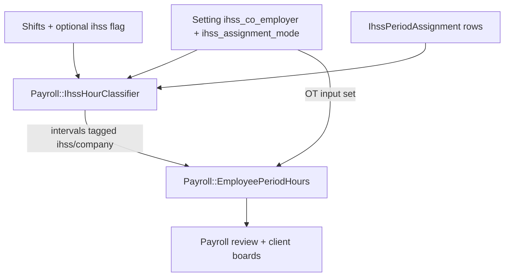

# IHSS tracking, co-employment, and overtime

## Product rules (locked)

**Settings (company singleton)**

1. `ihss_co_employer` (boolean)
   - `false`: overtime math uses only non-IHSS hours. Agency OT liability ignores IHSS hours.
   - `true`: overtime math uses all hours (IHSS + non-IHSS).

2. `ihss_assignment_mode` (`shift` | `period`)
   - `shift`: in payroll review, each shift is manually marked IHSS or not.
   - `period`: once per pay period, staff enter IHSS hours per employee+client in one board; the engine consumes those hours against that client's shifts in chronological order.

Authorized hours stay on [`Client`](app/models/client.rb) (`ihss_authorized_hours`). Period UIs show **IHSS hours used in this period** next to that authorization budget (same number staff already edit on the client profile). No monthly proration in this pass.

## Architecture

## Data model

1. **Settings** on [`app/models/setting.rb`](app/models/setting.rb)
   - `ihss_co_employer` default `false`
   - `ihss_assignment_mode` default `"shift"`, inclusion `shift`/`period`

2. **Shift flag** (used when mode is `shift`)
   - `shifts.ihss` boolean, default `false`, not null
   - Toggle only while period is open (not finalized); same auth as other payroll shift edits

3. **Period assignments** (used when mode is `period`)
   - New table `ihss_period_assignments`: `pay_period_id`, `employee_id`, `client_id`, `hours` (decimal)
   - Unique on `[pay_period_id, employee_id, client_id]`
   - Model under `Payroll::IhssPeriodAssignment` (or top-level `IhssPeriodAssignment` if that matches naming nearby)
   - Edits locked when `pay_period.finalized?`

## Hours / OT engine

Extend the collector + calculator; keep the public `EmployeePeriodHours.call` entrypoint.

1. Enrich [`Payroll::WorkInterval`](app/services/payroll/work_interval.rb) with `ihss:` (boolean) and `client_ids:` (for period consumption / utilization).

2. [`ScheduledShifts`](app/services/payroll/work_interval_collectors/scheduled_shifts.rb) loads clients on the calendar event.

3. New `Payroll::IhssHourClassifier`
   - **shift mode:** `interval.ihss = shift.ihss`
   - **period mode:** for each employee, take assignments for the period; walk that employee's intervals in start-time order; for each interval that includes the assignment's client, mark hours as IHSS until the assignment hours are exhausted (split an interval across the boundary when needed). Remainder is company.

4. Update [`Payroll::EmployeePeriodHours`](app/services/payroll/employee_period_hours.rb)
   - Build OT from the **OT-eligible** set: all intervals when co-employer, else only non-IHSS intervals
   - Keep existing daily/weekly thresholds, overnight split, and exemption rules on that set
   - Return expanded hash (string employee keys, lockstep with today's contract):
     - `regular_hours`, `ot_hours`, `shift_ot_hours` (agency-facing OT result)
     - `ihss_hours`, `company_hours`

## Testing (first-class)

IHSS classification and overtime are one compliance surface. Specs land with the engine work, not as a follow-up. Prefer service specs with a fake collector (already used in [`employee_period_hours_spec.rb`](spec/services/payroll/employee_period_hours_spec.rb)) for pure math; use shift/client factories when testing classification from persisted data.

### Audit of current OT coverage

[`spec/services/payroll/employee_period_hours_spec.rb`](spec/services/payroll/employee_period_hours_spec.rb) today covers:

- Empty employee ids
- Single same-day 8h shift (0 OT)
- Overnight split at exactly 8h (0 OT)
- Overnight past daily threshold (OT on morning side)
- Shift ending at midnight counted as regular
- Daily OT on one long shift
- Proportional `shift_ot_hours` across two same-day shifts
- Custom collector without DB shifts
- Smoke: call does not raise

**Gaps to close in the same pass** (existing OT feature, independent of IHSS):

- Weekly OT when a week exceeds `overtime_weekly_hours` with no daily OT
- Combined daily + weekly OT in one period (assert totals and that both feed `ot_hours` / `shift_ot_hours`)
- Multi-day week that crosses the weekly boundary correctly relative to `payroll_period_day`
- Active `OvertimeExemption` excluding matching intervals from OT **through** `EmployeePeriodHours` (model `#matches?` is tested; engine path is not)
- Inactive exemptions ignored by the engine
- Multiple employees in one `.call` (isolation of totals)
- Non-default thresholds (e.g. daily 10 / weekly 45) still drive math

### New IHSS + co-employer matrix

`Payroll::IhssHourClassifier` (or equivalent) specs:

- Shift mode: flagged shift -> IHSS; unflagged -> company
- Period mode: consumes assignment hours chronologically against client-matching intervals
- Period mode: splits one interval when assignment exhausts mid-shift
- Period mode: assignment for client A does not consume hours on client B-only shifts
- Period mode: assignment hours above matching shift capacity stop at available hours (no phantom IHSS)

`EmployeePeriodHours` IHSS OT specs (use collector stubs so numbers stay obvious):

- Co-employer off, mixed under thresholds (30 IHSS + 5 company): 0 agency OT
- Co-employer off, same day 6 IHSS + 10 company (daily 8): OT from company 10 only (2h)
- Co-employer off, 10 IHSS + 0 company: 0 agency OT even though IHSS exceeds daily
- Co-employer on, 35 IHSS + 10 company (weekly 40): OT from combined 45 (5h)
- Same 35+10 with co-employer off: OT from company 10 only (0 weekly OT)
- Co-employer on, mixed same-day hours over daily 8: OT input includes all hours that day
- Exemptions + IHSS: exempted intervals leave the OT-eligible set; classification still counts them in `ihss_hours` / `company_hours`

Also assert return shape always includes `ihss_hours` and `company_hours`, and `regular_hours + ot_hours` stays consistent with the OT-eligible rule (state the invariant in the example descriptions).

### Persistence / request / surface specs

- Setting defaults, validation, IHSS settings page update
- Shift `ihss` toggle: success when open; rejected when finalized; unauthorized
- Period assignment upsert: unique employee+client+period; locked when finalized
- Payroll period / employee review / client period request specs: hours map keys lockstep with rendered employee/client ids; IHSS used vs `ihss_authorized_hours` on client surfaces
- Hours export (if it keeps using `EmployeePeriodHours`): still correct under co-employer off with mixed hours

### Frontend

- Vitest for assignment-mode UI branches only where logic lives in domain components (toggle visibility / metrics). Prefer request + service specs for compliance math; do not duplicate OT arithmetic in JS tests.

## Settings UI

Add Settings > Payroll > IHSS (mirror schedule/overtime pattern in [`Settings::PayrollsController`](app/controllers/settings/payrolls_controller.rb)):

- Co-employer: yes/no
- Assignment mode: Assign by shift / Assign by period

Wire routes, menu entry, permit keys, request specs.

## Payroll UI

**Shift mode**

- IHSS toggle on shift rows in employee review ([`ReviewTable`](app/frontend/domains/TimeSheets/ReviewTable.tsx) / related) and client review tables
- Endpoint: member update on shift under payroll (or extend existing payroll shifts controller) setting `ihss`; reject when finalized

**Period mode**

- New period board (e.g. `/payroll/periods/:id/ihss`) listing employees who have hours in the period, with per-client IHSS hour inputs in one form
- Save replaces that period's assignment set for the submitted employees
- Link from period show when assignment mode is `period`

**Surfaces that consume hours**

- Employee review metrics: show IHSS vs company alongside regular/OT
- Period employee table: add IHSS / company columns from the same `EmployeePeriodHours` payload
- Client period board + client overview: show period (or loaded) IHSS used vs `ihss_authorized_hours`
- Holistic integrity: one load of page employees/clients; hours maps keyed to the same ids; request specs assert key lockstep

## Permissions / audit

- Reuse Timesheet / PayPeriod update (or index) grants for IHSS toggles and period assignments; no new resource unless catalog already forces one
- Paper Trail on shift `ihss` and on assignment rows if those models already use it elsewhere for payroll edits

## Docs

After implementation, mark the relevant Phase 7 checklist items in [`.cursor/icr.mdx`](.cursor/icr.mdx) and add a short Feature Documentation note for the two settings and OT rule (only the lasting product rule, not a play-by-play).

## Out of scope for this plan

- External IHSS/CMIPS/EVV file or API integrations
- Automated assignment rules beyond period-hour consumption against client shifts
- Changing how `ihss_authorized_hours` is defined on the client (still a single budget number)
