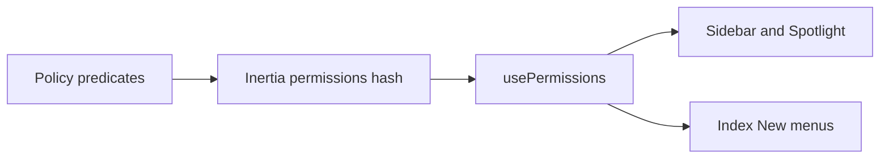

# Permission UI visibility

Phase 1 still has **UI visibility controls based on user permissions** open. The server already builds a `permissions` hash in [`app/controllers/concerns/inertia_share/permissions.rb`](app/controllers/concerns/inertia_share/permissions.rb) by running each policy predicate. The UI barely reads it: the sidebar and spotlight gate only Clients, and [`usePermissions`](app/frontend/lib/hooks/usePermissions.ts) always returns true.

The hash key is `PolicyClass` minus `Policy`, underscored and pluralized (`PayPeriodPolicy` becomes `pay_periods`, `Employee::TrainingPolicy` becomes `employee/trainings`). Predicates are evaluated against an unsaved record, which matches `authorize Model.new` (the New pages) and the collection `index?` checks. Row edit and bulk delete stay unchanged, because those checks depend on a saved record.

## Shared hash the UI can trust

- Remove the 5-minute `user_permissions/#{id}` cache in [`InertiaShare::Permissions`](app/controllers/concerns/inertia_share/permissions.rb). `User#permission?` already memoizes the resolver for the request. A cached hash would keep hiding or showing links after a role or group change.
- Keep Settings honest. [`SettingsController#show`](app/controllers/settings_controller.rb) calls `authorize Setting` (the class). The share currently builds `SettingPolicy` from `Setting.new` or `nil`, which can answer a different resource than that authorize call. Evaluate `SettingPolicy` against the same class the controller passes, and cover it with a request spec: `permissions.settings.show` is true for a user who can open settings and false for a user who cannot.

## One nav catalog

Add a small catalog (next to the sidebar) that both [`Sidebar`](app/frontend/layouts/AppLayout/Sidebar/index.tsx) and [`Spotlight`](app/frontend/features/Spotlight/index.tsx) render through `usePermissions`. Dashboard stays visible; [`PagesController`](app/controllers/pages_controller.rb) does not authorize it.

- Clients section when any of `clients.index`, `households.index`, `doctors.index` is true. Each child link uses its own `index`.
- Employees section when any of `employees.index`, `requirement/requirements.index`, `employee/trainings.index` is true. Same per-link split.
- Payroll uses `pay_periods.index` ([`PayPeriodsController`](app/controllers/pay_periods_controller.rb) authorizes `PayPeriod`, and [`PayPeriodPolicy#index?`](app/policies/pay_period_policy.rb) is the check).
- Vendors uses `vendors.index`.
- Settings uses `settings.show`.

Spotlight static actions are that same list. Search hits stay as the API returns them; [`Api::SpotlightsController`](app/controllers/api/spotlights_controller.rb) already `policy_scope`s them.

## New actions and the permissions screens

- Extend the index menu option type in [`IndexTableTitleSection`](app/frontend/features/IndexPageTemplate/TableTitleSection.tsx) with the resource key. Hide an option unless `can("new", resource)`. Apply that to the existing New menus: employees, households, doctors, vendors, requirements, trainings, interviews, incident reports, shift templates, people (`people`), job titles (`employee/job_titles`), departments (`employee/departments`).
- Replace the stub hook so `can(action, resource)` reads `permissions[resource][action] === true`.
- Add `Permission::GroupPolicy` (standard `ApplicationPolicy` auth, resource `permission/groups`) and `authorize` in [`PermissionsController`](app/controllers/permissions_controller.rb). Point the index New button and the table Edit/Delete links at `permission/groups` with `create`, `update`, and `destroy`. Group checks are not owner-scoped, so the unsaved-record hash matches those buttons.

## Tests and notes

- Request spec on the shared hash: an allowed user gets the nav flags above, a user without that permission gets them false, including `settings.show`.
- Policy spec for `Permission::GroupPolicy`, plus a request spec that a user without the permission is refused on the permissions index.
- Vitest for `usePermissions` and for the catalog: a denied `index` drops that link from the sidebar list and from spotlight static actions; a parent section stays when only a child is allowed.
- Mark the Phase 1 checkbox in [`.cursor/icr.mdx`](.cursor/icr.mdx) and add one Permission System note: the shared hash is the UI source for index and new, evaluated against an unsaved record (Settings against the class).
