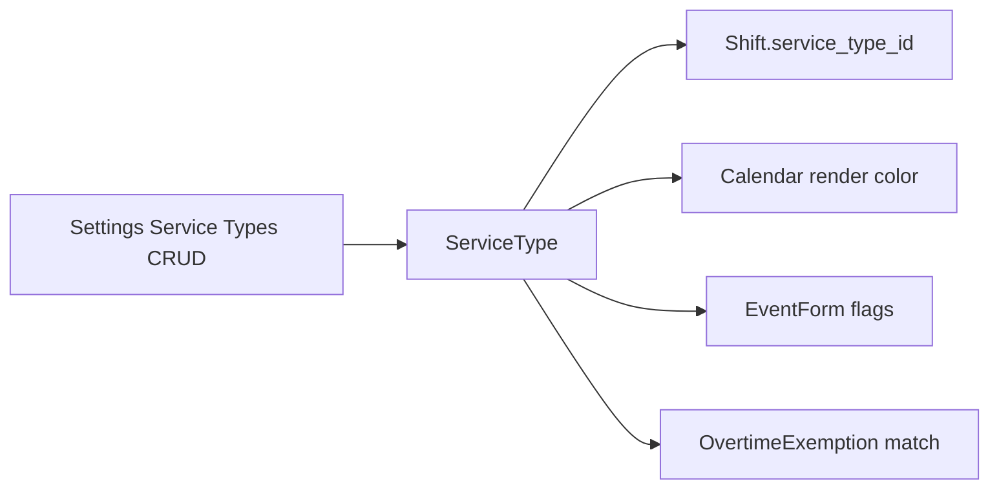

# Phase 9.1: Configurable service types

## Why this feature

Compliance / Hazard Assessment is already being implemented under [`.cursor/plans/compliance_form_system_8e249fb1.plan.md`](.cursor/plans/compliance_form_system_8e249fb1.plan.md), so this plan deliberately avoids that surface.

Next open milestone after payroll/IHSS closeout is **Phase 9** in [`.cursor/icr.mdx`](.cursor/icr.mdx). Today shift "types" are plain [`Category`](app/models/category.rb) rows (`categorizable_type: "Shift"`) managed at Settings > Calendar > Shift Types ([`ShiftTypes.tsx`](app/frontend/domains/Settings/Calendar/ShiftTypes.tsx)). That model has no billable/payable flags, multi-client rules, notes/mileage gates, or calendar colors.

This plan ships **service types + calendar/shift linkage only**. Client authorization hours ledger and utilization reporting are Phase 9.2 (separate plan).

## Locked design

- New model **`ServiceType`** (company-wide, single-tenant). Do not overload `Category`.
- **`shifts.service_type_id`** is the operational type for scheduled work. `Calendar::Event.category` stays the coarse event kind (e.g. system "Shift").
- Replace Settings > Calendar > **Shift Types** UI with **Service Types** (same nav slot / route family under calendar settings).
- Migrate existing `Category.type("Shift")` rows into `ServiceType` records; backfill `shifts.service_type_id`; stop writing shift type via `category_id` for new/updated shifts.
- Remap [`OvertimeExemption`](app/models/overtime_exemption.rb) field `category` matching to **service type slug** (same exemption UI, new value source).
- Keep `shifts.category_id` column through a short dual-write/backfill window only if needed for safe deploy; remove usage from APIs and serializers in this ship. Prefer drop-not-null / remove FK in a follow-up migration once backfill is verified if dropping in the same PR is too risky - default: nullify and stop requiring it once `service_type_id` is required.

## Model

`service_types` table:

- `name`, `slug` (FriendlyId), `active` (bool), `system` (bool), `position` (int)
- `billable` (bool), `payable` (bool)
- `allows_multi_client` (bool)
- `requires_notes` (bool), `tracks_mileage` (bool)
- `color` (string, hex) for calendar event chrome
- timestamps

Validations: unique name/slug; color format; at least one of billable/payable true for active types (company ops default).

`Shift belongs_to :service_type`. Seed a default system type (e.g. "Standard") and migrate names from existing Shift categories.

Permissions: catalog key `service_type` -> `ServiceType` with CRUD; seed Director full, Facilitator index/show (mirror category/settings patterns). Settings pages authorize via that policy.

## Settings CRUD

- Replace [`Settings::CalendarsController#shift_types`](app/controllers/settings/calendars_controller.rb) surface with service types index (Inertia).
- Domain UI under `app/frontend/domains/Settings/Calendar/ServiceTypes/` (one component per file; no local helpers).
- Fields editable: name, flags, color, active, position. System rows: no delete; name editable only if that matches current Shift Types protected behavior.
- API create/update/destroy (or Inertia form posts) with specs.

## Calendar and shift wiring

- [`Api::CalendarEventsController`](app/controllers/api/calendar_events_controller.rb): accept `shift_attributes.service_type_id` (resolve slug like today's `resolve_shift_category`); drop shift `category_id` from the write path.
- Event form + payroll Add Shift: service type select from active types; apply `allows_multi_client` (block/limit extra client participants), `requires_notes` (require notes on save), surface mileage field when `tracks_mileage`.
- Calendar serializers / render: include `service_type` `{ id, name, color, flags }`; time-grid and month event chrome use `color`.
- Payroll shift category PATCH ([`Payroll::ShiftsController#category`](app/controllers/payroll/shifts_controller.rb)): retarget to update `service_type_id` (rename route/action to `service_type` for clarity).

## Overtime exemptions

- When exemption `field == "category"`, compare against `shift.service_type.slug` (update [`OvertimeExemption`](app/models/overtime_exemption.rb) and its settings option lists to load ServiceType slugs).
- Data migration: rewrite stored exemption values from old category slugs to new service type slugs using the migration map.

## Specs and integrity

- Model: flags, uniqueness, system protect.
- Request: settings CRUD; calendar create/update with service_type; multi-client and requires_notes enforcement.
- Payroll: hours/OT exemption still matches after remap; employee/client review still lockstep on shift ids.
- Frontend smoke: Settings list; event form select; calendar color present on serialized occurrence.
- Migration spec or service: every former Shift category maps to a ServiceType; every shift gains `service_type_id`.

## Docs

- Check Phase 9 first bullet in `.cursor/icr.mdx` when done.
- Short Feature Documentation note: ServiceType vs Category (event kind), flags, calendar color, Settings entry point.
- Leave authorization ledger / utilization reporting unchecked.

## Out of scope

- Client authorization hours ledger and auth utilization reports (Phase 9.2)
- IHSS automated assignment rules (Phase 7 leftover; separate medium plan)
- Compliance forms / hazard assessments
- EVV service-code mapping (Phase 14)
