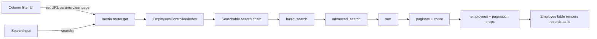

# Server-side Employees DataTable filters

## Decision (locked)

**Server-side column filters before paginate** for `/employees`. Filters and pagination share one relation so row set and footer `count` stay lockstep with `?search=`.

Rejected for this screen:
- Client filter of the current page (instant, but pagination lies).
- Full in-memory employee list for snappier client filter/page (honest only if server pagination is dropped; fights existing Searchable/search/sort stack).

Snappiness on this path: debounce text columns (~300-500ms), apply checkbox filters immediately, Inertia partial reload with `preserveState` / `preserveScroll` / `only: ["employees", "pagination", "job_title_options"]`.

## Problem

- Global search is already server-side (`?search=` → [`Searchable#basic_search`](app/controllers/concerns/searchable.rb) → `Employee.search`).
- Column filters in [`EmployeeTable`](app/frontend/domains/Employees/Table.tsx) + [`filterEmployees`](app/frontend/domains/Employees/filterEmployees.ts) filter the **current page payload** in React. Pagination `count` / pages still come from the unfiltered server relation, so default `employed` makes the footer lie.
- Goal: column filters + search both run on the server before `paginate` / `count`.

## Architecture

Reuse existing **Searchable advanced search** (`params[:adv] == "true"` + `advanced_search_params`). Do **not** use [`NestedURLSearchParams`](app/frontend/lib/Collections/NestedURLSearchParams.ts) for multi-select (arrays become comma strings / break `[]` parsing). Mirror sort/search: plain `URLSearchParams` + `router.get` like [`DataTable.tsx`](app/frontend/components/Table/DataTable/DataTable.tsx) and [`SearchInput.tsx`](app/frontend/components/Table/SearchInput/SearchInput.tsx).

## Committed behaviors

1. **Default status:** If `statuses` is absent from the request, Employees index applies `employed` (use `Employee.actively_employed` / `where(status: :employed)`). If `statuses` is present (including empty), honor it: non-empty → `where(status: statuses)`; empty → no status constraint (user cleared / selected none meaning "any").
2. **URL contract** (flat Rails-friendly keys, always set `adv=true` when any column filter key is present):
   - `adv=true`
   - `first_name`, `last_name`, `number`, `active_at` (hire date substring / date string as today UI does)
   - `job_title` (text ILIKE on `job_titles.name`)
   - `job_titles[]` (exact name match, multi)
   - `statuses[]` (enum names: `applicant|offered|employed|declined|terminated`)
3. **Apply before paginate:** Filters live inside `search(...)` so [`EmployeesController#index`](app/controllers/employees_controller.rb) `employees.count` and `paginate(employees)` stay lockstep.
4. **Client stops filtering records:** `EmployeeTable` hydrates filter controls from the URL and writes URL changes; `records` pass straight to `Table.DataTable`.
5. **Job title options:** Server prop `job_title_options: string[]` (ordered distinct `Employee::JobTitle` names). Do not derive options from the current page.
6. **JobTitles Show:** [`Settings::JobTitlesController#show`](app/controllers/settings/job_titles_controller.rb) is not Searchable/paginated. Pass a prop/flag so `EmployeeTable` **does not** enable URL column filters there (association already scoped via `active_employees`). No client `filterEmployees` there either for this pass.

## Backend work

### Extend [`EmployeesController`](app/controllers/employees_controller.rb)

- Expand `advanced_search_params` to permit:
  - `:first_name`, `:last_name`, `:number`, `:active_at`, `:job_title`
  - `job_titles: []`, `statuses: []`
- Keep existing `created_at: [:start, :end, :type]` permit (request specs already use it); no column UI for it.
- Register custom advanced-search handlers (merge into `internal_advanced_search_methods` for this controller, or apply a small Employees-specific filter method called from the expose). Required custom logic:
  - `first_name` / `last_name` → `people.first_name` / `people.last_name` ILIKE (person already `left_joins`ed)
  - `number` → employees.number ILIKE (default handler may work)
  - `active_at` → ILIKE/cast on `employees.active_at` consistent with current text filter intent (string contains); keep it simple and documented in specs
  - `job_title` → join active job title, `job_titles.name ILIKE`
  - `job_titles` → join active job title, `job_titles.name IN (...)`
  - `statuses` → coerce to known enum keys only; `where(status: statuses)`
- **Default employed when `statuses` key absent:** apply in the expose/search pipeline for index (e.g. wrap relation with `actively_employed` before/after advanced_search when `params[:statuses]` is nil). Do not apply this default when `statuses` key is present.
- Index props: add `job_title_options` (and nothing else unless needed). Keep `employees` + `pagination`.

Factory gotcha: [`spec/factories/employees.rb`](spec/factories/employees.rb) defaults `status { :applicant }`. Index specs that expect a bare `create(:employee)` on `/employees` must use `status: :employed` (or the new default will hide them).

### Searchable

Prefer **not** changing the global `adv=true` gate. Column filter visits always include `adv=true`. If a shared helper is needed to merge per-controller search methods, add a tiny class_methods API on Searchable; otherwise set handlers only on EmployeesController.

## Frontend work

### URL helpers (Employees domain)

Add something like `app/frontend/domains/Employees/employeeTableFilters.ts`:

- `readEmployeeTableFilters(urlSearchParams) → filters` (default UI statuses to `["employed"]` when param absent, matching server)
- `writeEmployeeTableFilters(url, filters)` using `searchParams.set/delete` and `append` for arrays (`statuses[]`, `job_titles[]`); set `adv=true` when any filter active; delete filter keys + `adv` when fully cleared except default employed may omit `statuses` to mean default
- Clear `page` on every filter write (same as search)
- Debounce text fields (~300–500ms); checkboxes apply immediately
- Inertia visit options: `preserveState`, `preserveScroll`, `replace: true`, `only: ["employees", "pagination", "job_title_options"]` when possible

Committed empty-vs-default rule for the client:

- Initial `/employees` (no `statuses`) → UI shows Employed checked; server defaults employed; **do not** force a redirect on mount.
- User unchecks Employed with nothing else selected → write `adv=true` and `statuses` as empty present key (e.g. `statuses=` or append blank then strip values) so server sees key present and applies no status filter. Implement the empty-array encoding in one place and cover it with a request spec + unit test.
- User selects multiple → `statuses[]=a&statuses[]=b`.

### [`EmployeeTable`](app/frontend/domains/Employees/Table.tsx)

- Props: `records`, `model`, `jobTitleOptions?: string[]`, `serverFiltered?: boolean` (Index passes `true` + options; JobTitles Show omits / false).
- When `serverFiltered`: no `filterEmployees`; hydrate from URL; filter onChange writes URL.
- When not `serverFiltered`: no column filters (plain columns only) for JobTitles Show.
- Keep badge/status column UI and i18n keys as they are.

### [`Employees/Index`](app/frontend/pages/Employees/Index/index.tsx)

- Accept `job_title_options` prop; pass into `EmployeeTable` with `serverFiltered`.

### Remove client filter path

- Delete or shrink [`filterEmployees.ts`](app/frontend/domains/Employees/filterEmployees.ts): keep shared constants/types (`EMPLOYEE_STATUSES`, status type) used by the table; remove `filterEmployees` / page-local `uniqueEmployeeJobTitles` from the Index path.
- Rewrite [`filterEmployees.test.ts`](app/frontend/tests/domains/Employees/filterEmployees.test.ts) into URL read/write tests (and/or drop obsolete client filter tests).

## Specs (required)

**Request** ([`spec/requests/employees_spec.rb`](spec/requests/employees_spec.rb)):

- Default index (no `statuses`) only returns employed; applicant fixture excluded.
- `adv=true&statuses[]=applicant` returns applicants.
- `adv=true` with empty statuses encoding returns all statuses (assert employed + applicant both present).
- Filters: `first_name`, `number`, `job_title` / `job_titles[]`, combined with `search`, and assert `pagination[:count]` equals filtered relation size (lockstep).
- Update existing index example to `create(:employee, status: :employed)`.
- Keep existing `number` / `created_at` advanced-search examples working (those employees should be `employed` if default applies when `statuses` absent; when `adv=true&number=...` without statuses, default employed still applies unless you explicitly pass statuses in those examples).

**Controller concern** (optional small addition in [`searchable_spec.rb`](spec/controllers/concerns/searchable_spec.rb) only if you add shared Searchable API).

**Frontend:** unit tests for URL read/write helper (array encoding, default employed when absent, empty statuses key, clears `page`).

Run: `bundle exec rspec spec/requests/employees_spec.rb` and the touched Vitest file(s).

## Out of scope

- Restoring the Advanced Search panel UI.
- Server-filtering JobTitles Show.
- Changing global search (`?search=`) behavior beyond composing with column filters.
- Reworking NestedURLSearchParams array support.
- Virtualization / dropping server pagination for a full client-side Employees index.

## Implementation order for the other agent

1. Backend permit + handlers + default employed + `job_title_options` prop + request specs.
2. Frontend URL helper + wire `EmployeeTable` / Index; disable filters on JobTitles Show.
3. Remove client `filterEmployees` usage; fix Vitest; run specs.
4. Manually smoke `/employees`: default employed, change status filter, confirm pagination count matches rows across pages.
